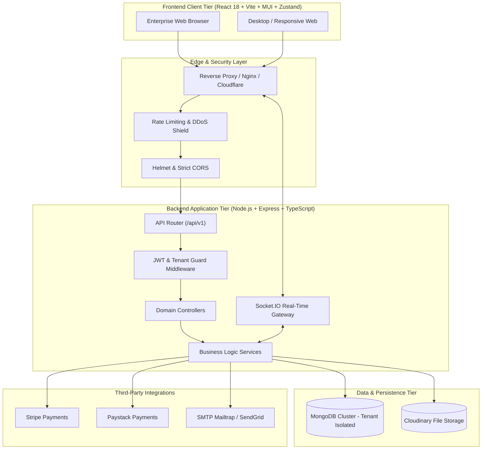
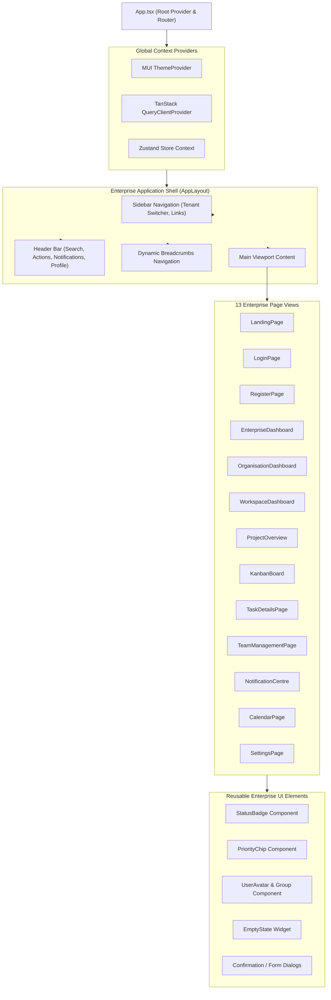
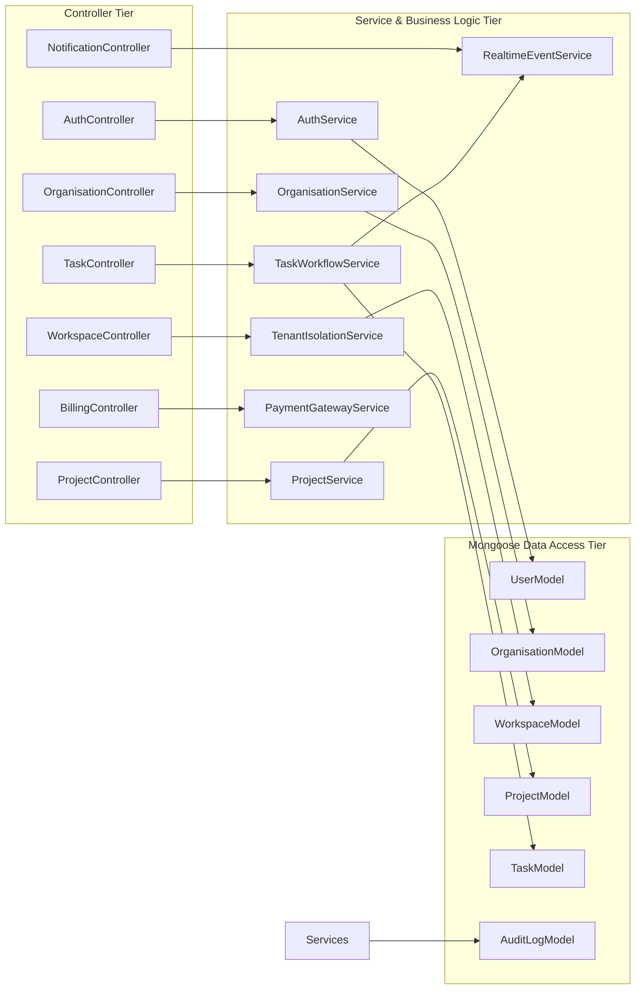
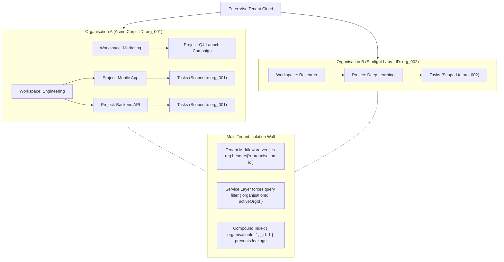
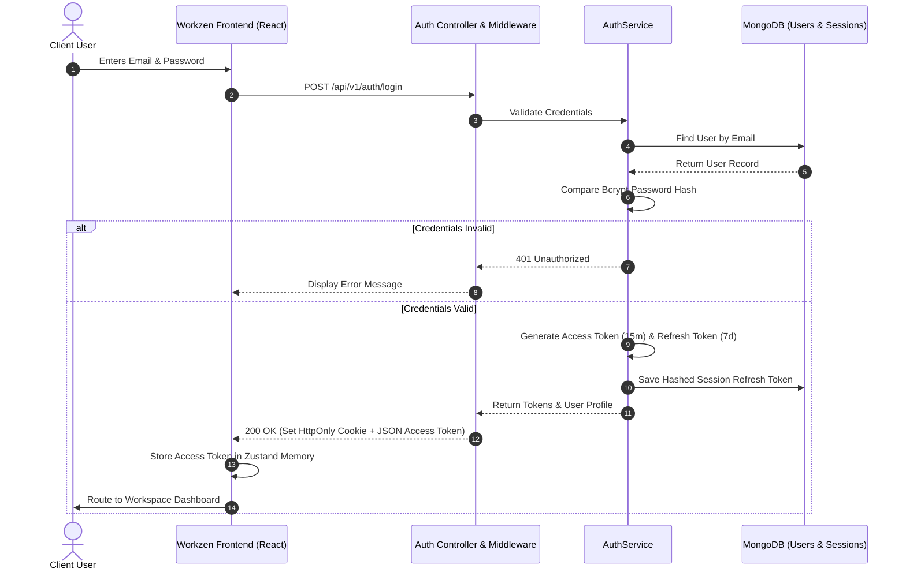
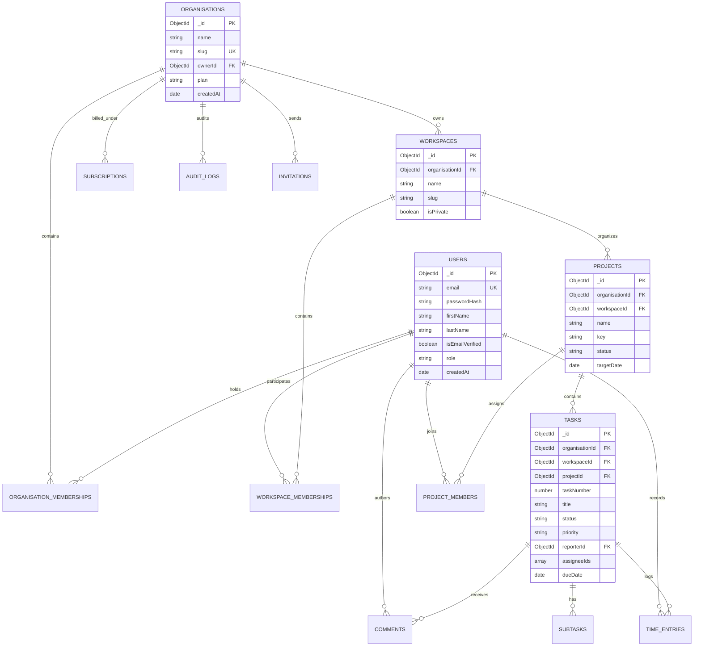
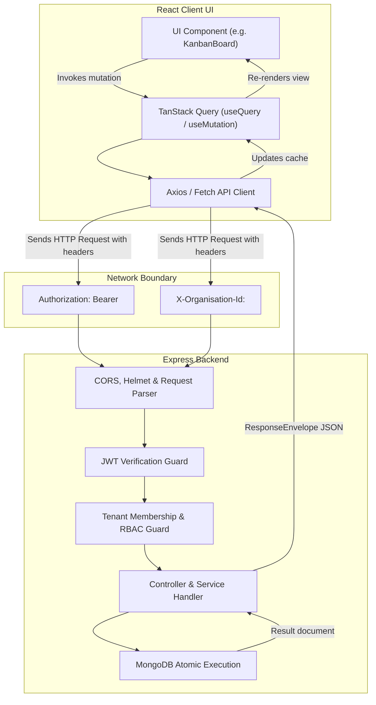
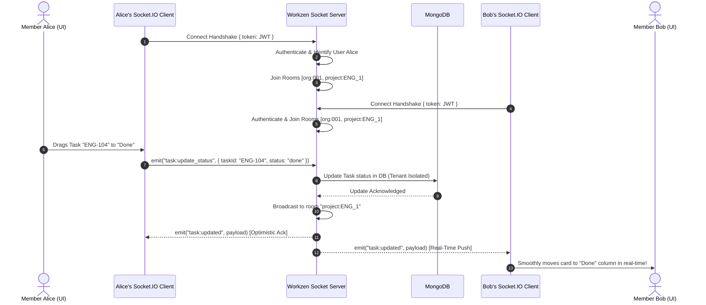

# WORKZEN — Architecture Diagrams Catalog

**Product:** WORKZEN  
**Category:** Enterprise Project Management & Team Collaboration SaaS  
**Format:** GitHub Flavored Markdown / Mermaid Diagrams  

---

## Diagram 1: Complete System Architecture

---

## Diagram 2: Unified Repository Architecture

```mermaid
graph TD
    Root["workzen (Root Directory)"]
    
    Root --> RootConfigs["Root Manifests & Configs"]
    RootConfigs --> Pkg["package.json (Single Root)"]
    RootConfigs --> Lock["package-lock.json"]
    RootConfigs --> Env[".env / .env.example"]
    RootConfigs --> TSConfig["tsconfig.json / tsconfig.server.json"]
    RootConfigs --> ViteConf["vite.config.ts"]
    RootConfigs --> Docker["Dockerfile & docker-compose.yml"]
    RootConfigs --> CI[".github/workflows/ci.yml"]

    Root --> Docs["docs/"]
    Docs --> Assessment["01-project-assessment.md"]
    Docs --> SysArch["02-system-architecture.md"]
    Docs --> DBMTR["03-database-and-multitenancy.md"]
    Docs --> SecArch["04-auth-and-security.md"]
    Docs --> Diags["05-architecture-diagrams.md"]
    Docs --> CompRep["06-phase1-completion-report.md"]

    Root --> Src["src/"]
    Src --> Shared["src/shared/ (Single Source of Truth)"]
    Shared --> SharedTypes["types/ (DTOs & Entity Interfaces)"]
    Shared --> SharedConst["constants/ (Roles, Statuses, Enums)"]
    Shared --> SharedVal["validation/ (Zod Schemas)"]

    Src --> Client["src/client/ (React + MUI + Bootstrap + Zustand)"]
    Client --> ClientComp["components/ (Layout, Modals, Common)"]
    Client --> ClientPages["pages/ (13 Enterprise Prototype Views)"]
    Client --> ClientStore["store/ (Zustand Global State)"]
    Client --> ClientTheme["theme/ (MUI & Bootstrap Integration)"]

    Src --> Server["src/server/ (Node.js + Express + TypeScript)"]
    Server --> ServConfig["config/ (DB, Cloudinary, Keys)"]
    Server --> ServCtrl["controllers/ (HTTP Handlers)"]
    Server --> ServMid["middleware/ (Auth, Tenant, RBAC, Limiter)"]
    Server --> ServModels["models/ (23 Mongoose Schemas)"]
    Server --> ServRoutes["routes/ (/api/v1 Endpoints)"]
    Server --> ServServices["services/ (Domain Business Logic)"]
    Server --> ServSocket["socket/ (Real-Time Gateways)"]
```

---

## Diagram 3: Frontend Component Architecture

---

## Diagram 4: Backend Service Architecture

---

## Diagram 5: Multi-Tenant Organisation Architecture

---

## Diagram 6: Authentication & Authorization Flow

---

## Diagram 7: MongoDB Entity Relationship Diagram (Key Collections)

---

## Diagram 8: Frontend-to-Backend Communication

---

## Diagram 9: Real-Time Socket.IO Communication

