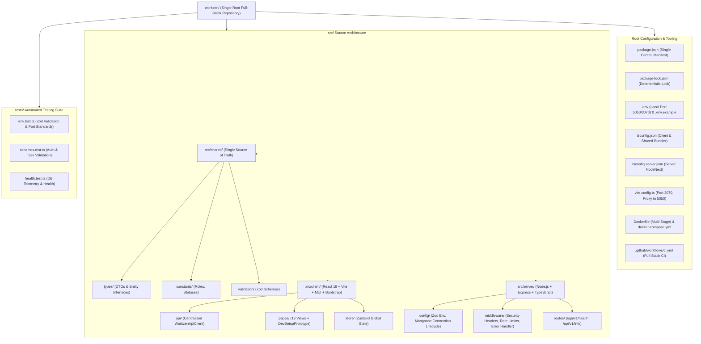
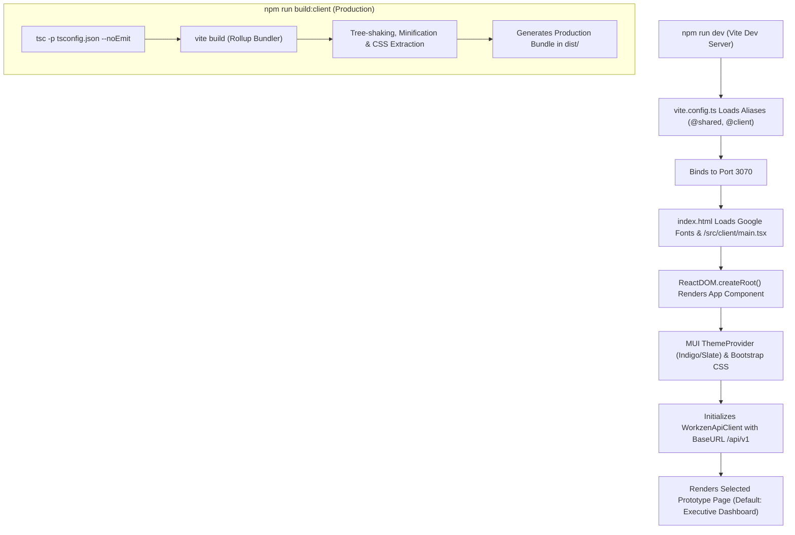
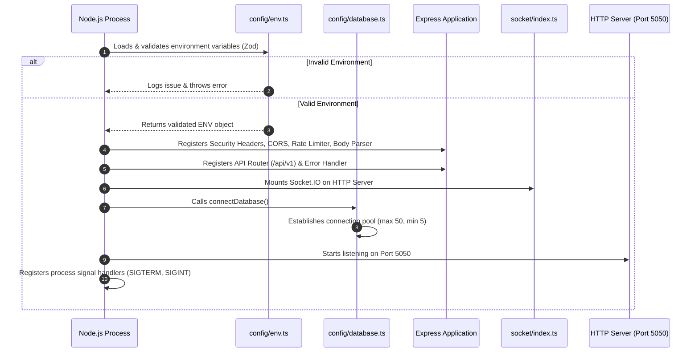
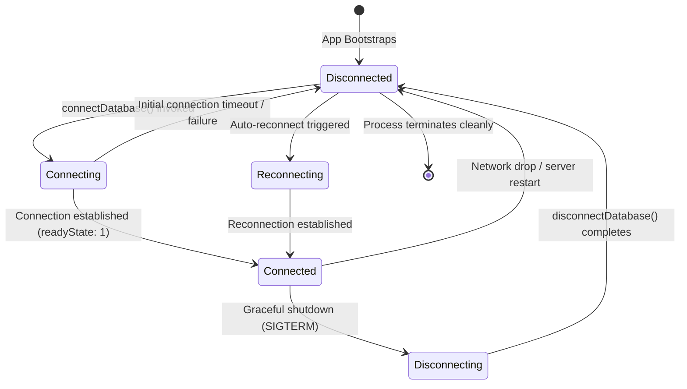
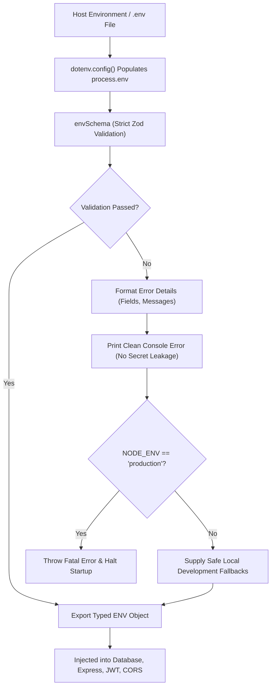
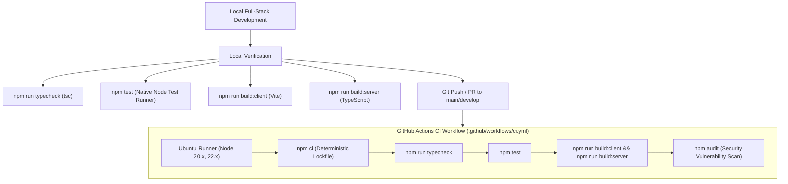
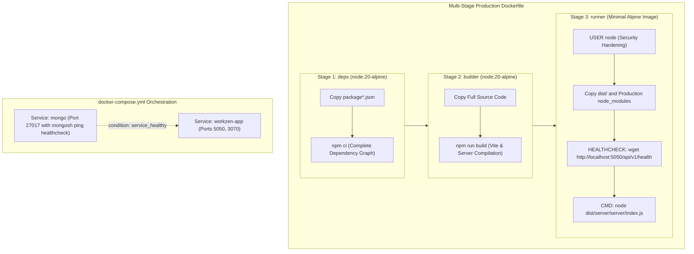

# WORKZEN — Phase 2: Code & Infrastructure Diagrams Catalog

**Project:** WORKZEN  
**Phase:** Phase 2: Project Setup, Configuration & Development Environment  
**Format:** GitHub Flavored Markdown / Mermaid Diagrams  

---

## Diagram 1: Unified Repository Structure

---

## Diagram 2: Frontend Startup & Build Flow

---

## Diagram 3: Backend Startup Flow

---

## Diagram 4: MongoDB Connection Lifecycle

---

## Diagram 5: Environment Variable Loading & Validation

---

## Diagram 6: Application Request Lifecycle

```mermaid
flowchart LR
    ClientReq["Incoming HTTP Request"] --> SecurityHeaders["Security Headers Middleware (CSP, HSTS, NoSniff)"]
    SecurityHeaders --> CorsGuard["CORS Whitelist Guard (Port 3070 Allowed)"]
    CorsGuard --> RateLimit["Sliding-Window Rate Limiter (Max 100 req/15m)"]
    RateLimit --> BodyLimit["JSON Parser (10MB Strict Limit)"]
    BodyLimit --> Logger["HTTP Request Logger (Method, URL, Duration)"]
    Logger --> Router["API Router (/api/v1)"]
    
    Router --> RouteHandler["Route Handler (e.g. /health)"]
    RouteHandler --> ResponseEnvelope["Standardized ResponseEnvelope JSON"]
    
    Router -.->|Error Thrown| GlobalErrorHandler["Centralized errorHandler (Zod / 500 Formatting)"]
    GlobalErrorHandler --> ResponseEnvelope
```

---

## Diagram 7: Development & CI Pipeline

---

## Diagram 8: Docker Production Build & Runtime Architecture

