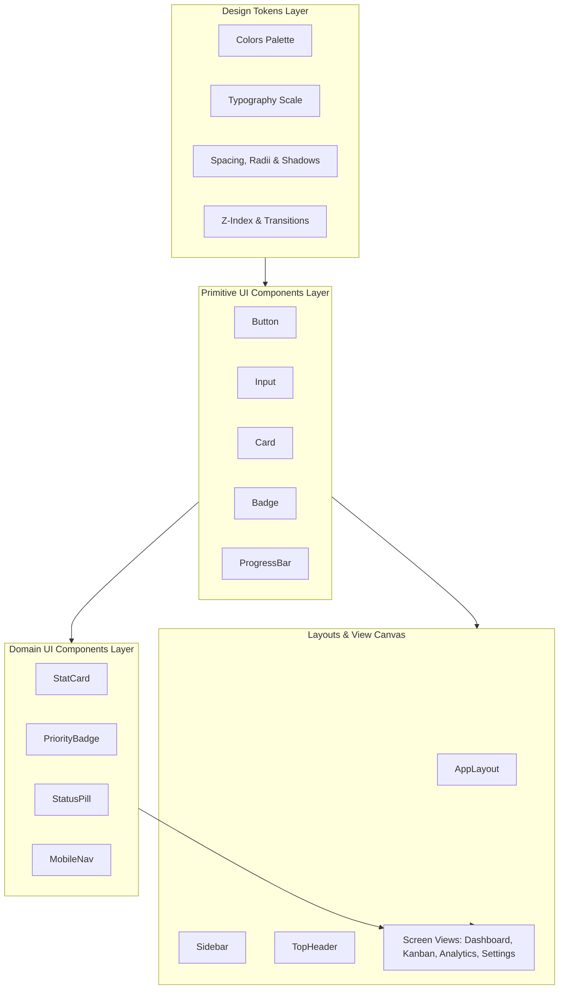
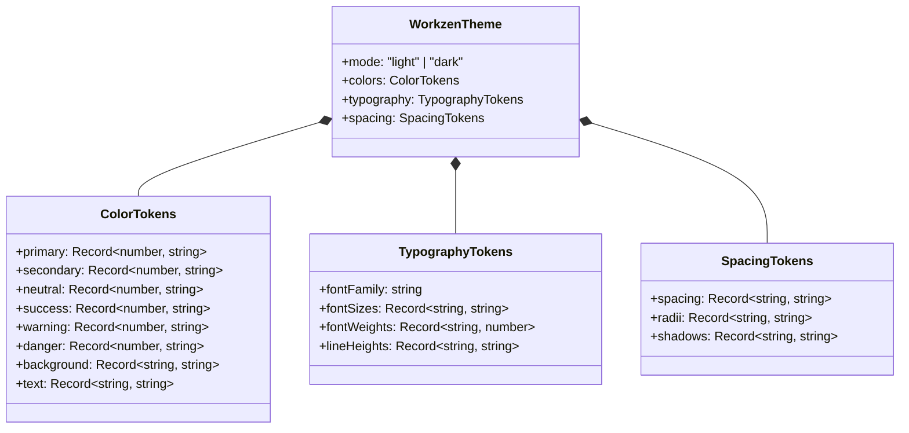
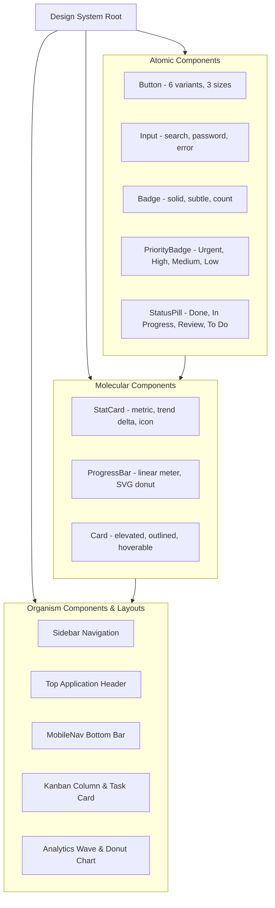
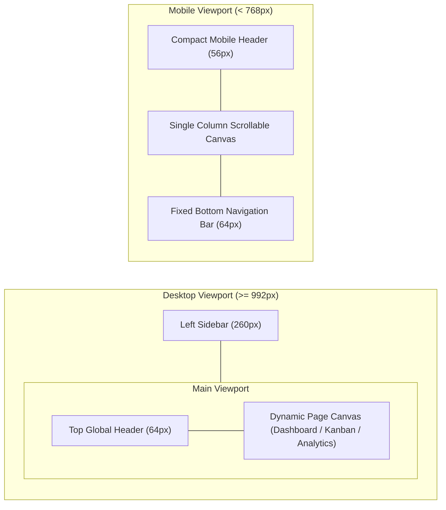
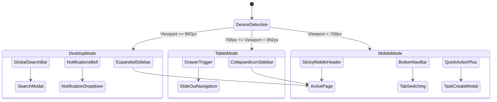
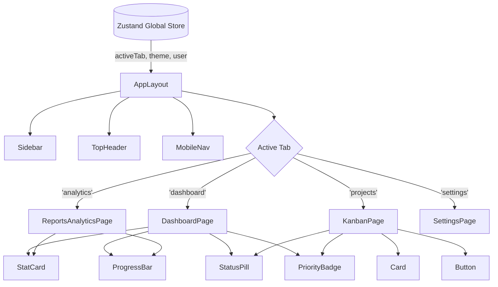
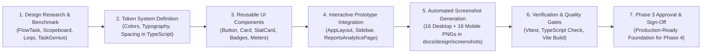

# WORKZEN — Phase 3 Design System Architecture Diagrams

This document contains the official architecture and workflow diagrams for Phase 3 of WORKZEN, modeling the design system tokens, component hierarchies, responsive navigation, and prototype workflows.

---

## Diagram 1: Design System Architecture

---

## Diagram 2: Theme and Token Structure

---

## Diagram 3: Reusable Component Hierarchy

---

## Diagram 4: Frontend Layout Architecture

---

## Diagram 5: Responsive Navigation Behaviour

---

## Diagram 6: UI Component Relationships & Data Flow

---

## Diagram 7: Prototype-to-Implementation Workflow

