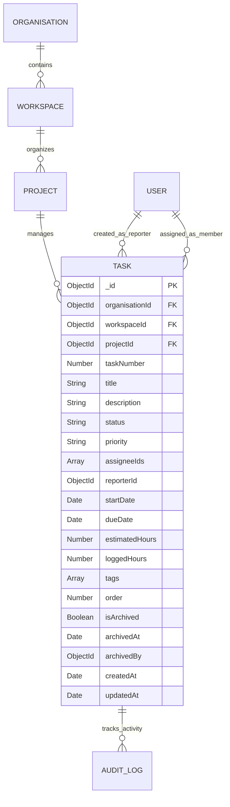
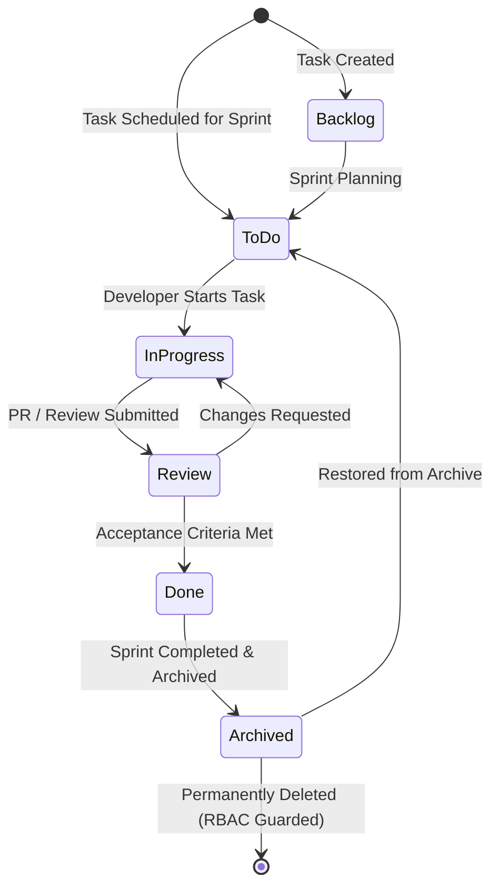
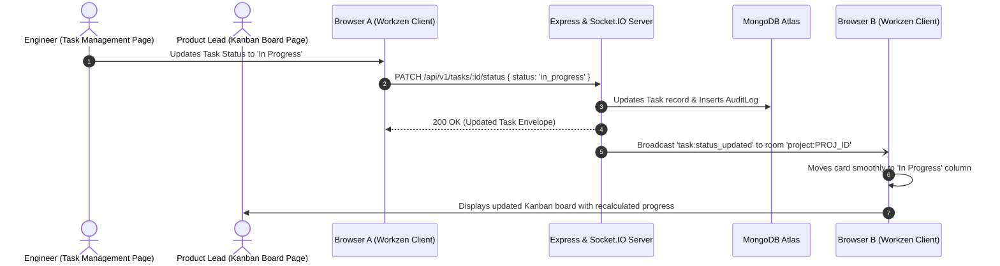

# WORKZEN — PHASE 14: TASK MANAGEMENT ARCHITECTURE & WORKFLOWS

---

### 1. Data Model & Entity Relationship Diagram

---

### 2. Task Lifecycle State Machine

---

### 3. Real-Time Bi-Directional Synchronization Workflow

