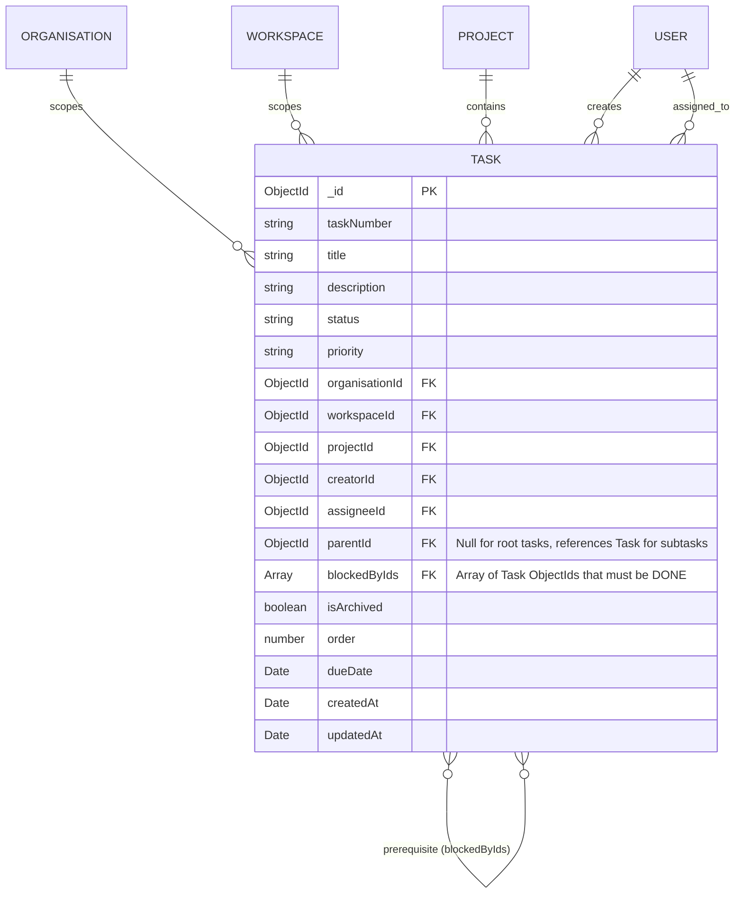
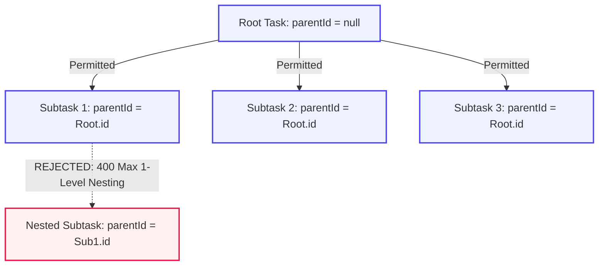
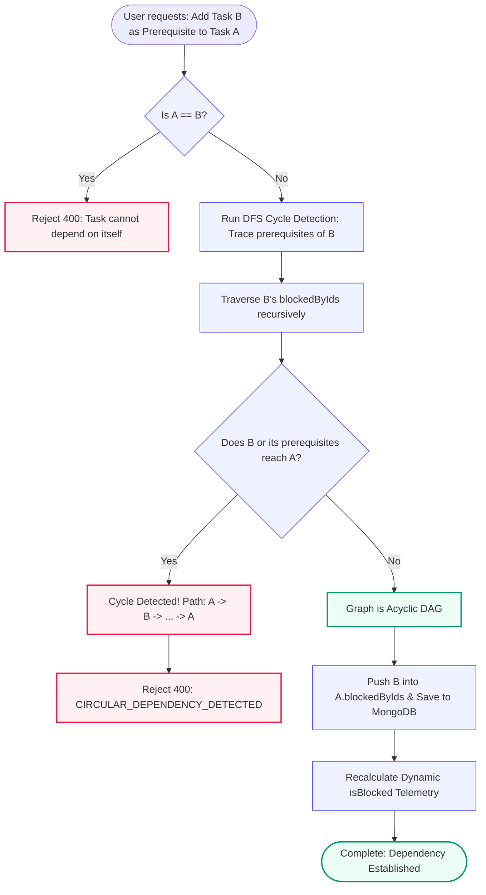
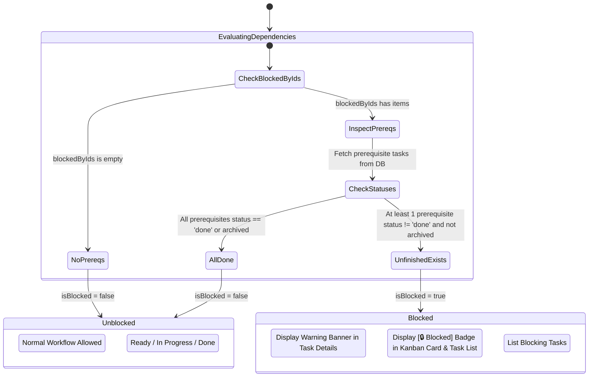

# Phase 15: Subtask & Dependency Architecture Diagrams

## 1. Entity Relationship & Data Model

## 2. Parent-Child Subtask Hierarchy & 1-Level Depth Rule

## 3. Depth-First Search (DFS) Cycle Detection Algorithm

## 4. Blocked State Machine & Telemetry Derivation

