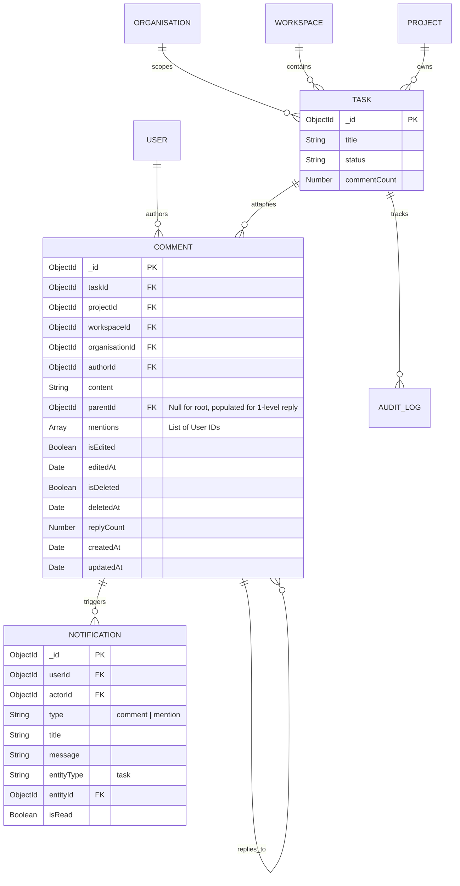
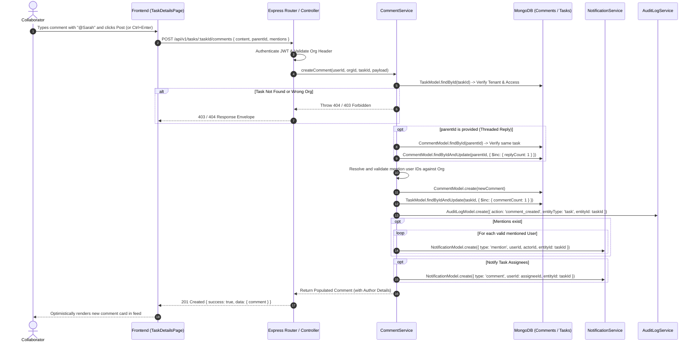
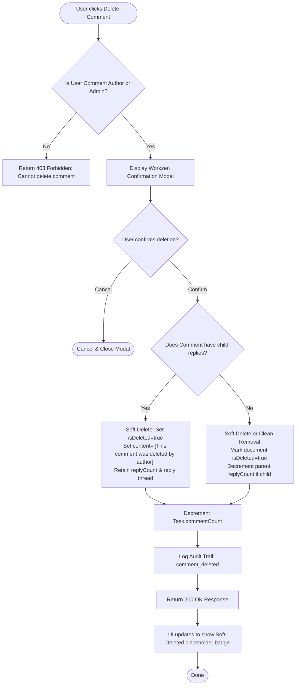

# WORKZEN — PHASE 16: COMMENT & DISCUSSION ARCHITECTURE

## 1. Domain Architecture & Entity Relationships

---

## 2. Comment Lifecycle & Mention Dispatch Sequence

---

## 3. Comment Deletion & Soft-Delete Preservation Flow

