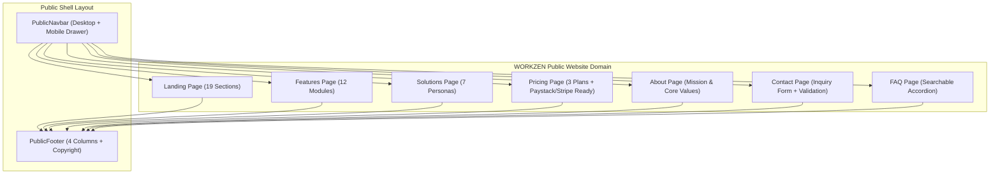
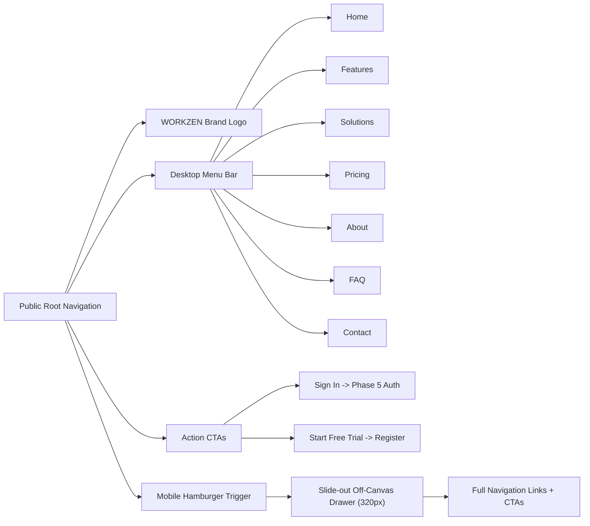
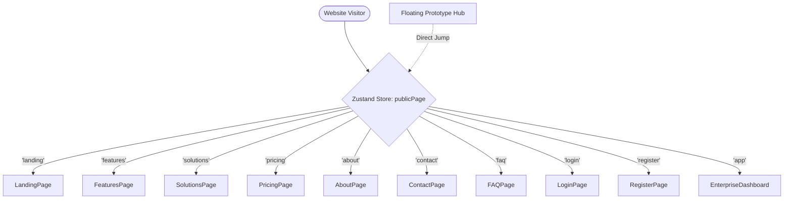
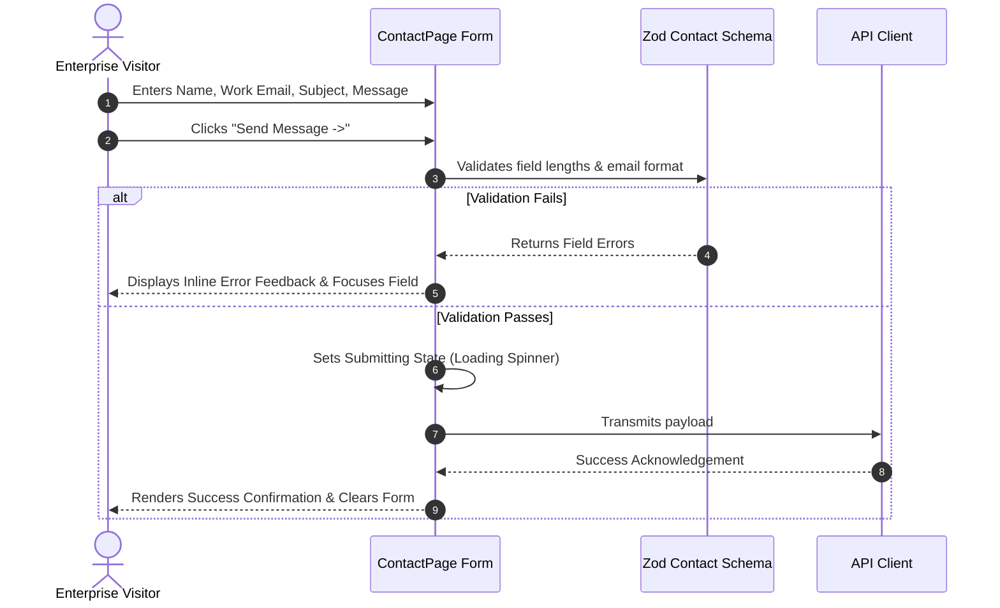
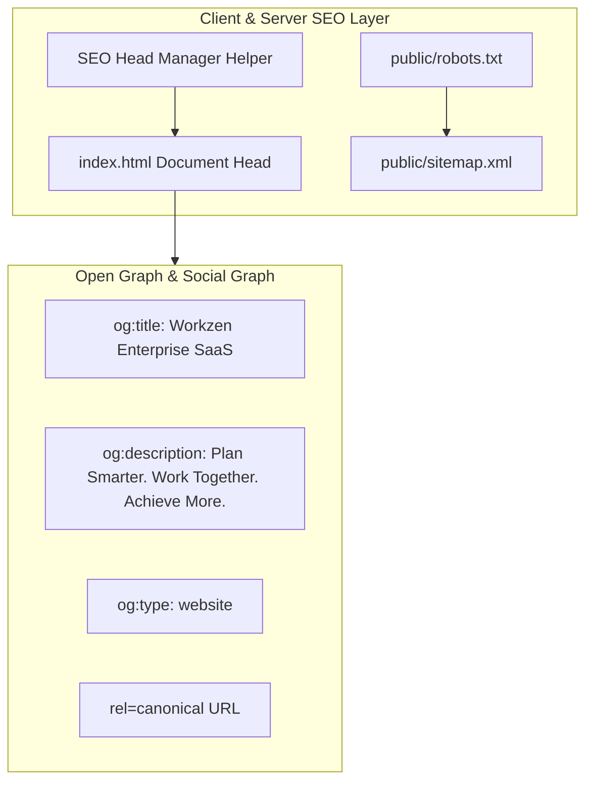
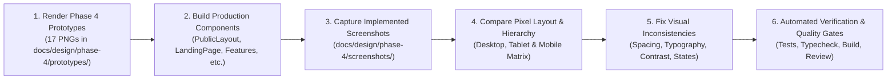

# WORKZEN — Phase 4 Public Architecture & Workflow Diagrams

This document contains the official architecture, component hierarchy, navigation, data flow, and verification diagrams for Phase 4 of **WORKZEN**.

---

## Diagram 1: Public Website Page Architecture

---

## Diagram 2: Public Navigation Structure

---

## Diagram 3: Landing Page Component Hierarchy

```mermaid
graph TD
    Landing[LandingPage Root]
    
    Landing --> S1[PublicNavbar]
    Landing --> S2[Hero Section with Gradient Mesh]
    Landing --> S3[Interactive Kanban Preview Canvas]
    Landing --> S4[Customer Problems 3-Card Grid]
    Landing --> S5[Platform Capabilities 4-Card Grid]
    Landing --> S6[3 Strategic Benefits Pillars]
    Landing --> S7[How Workzen Works 3-Step Flow]
    Landing --> S8[Target Use Cases Grid]
    Landing --> S9[Pricing Preview Cards]
    Landing --> S10[FAQ Accordion Preview]
    Landing --> S11[Final Conversion Call-To-Action]
    Landing --> S12[PublicFooter]
```

---

## Diagram 4: Public Website Routing & State Flow

---

## Diagram 5: Contact Form Data Flow & Validation

---

## Diagram 6: SEO & Metadata Architecture

---

## Diagram 7: Prototype-to-Implementation Comparison Workflow

