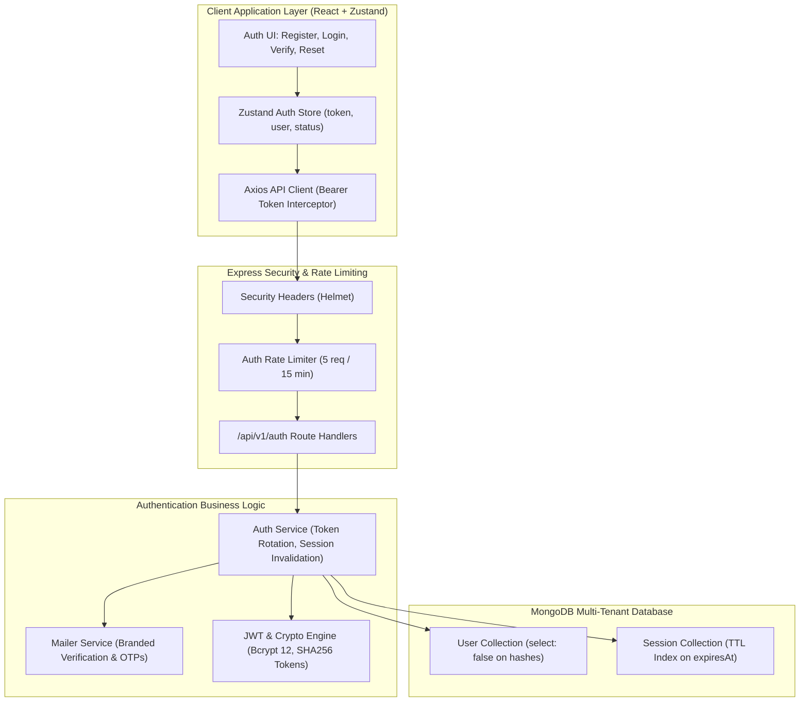
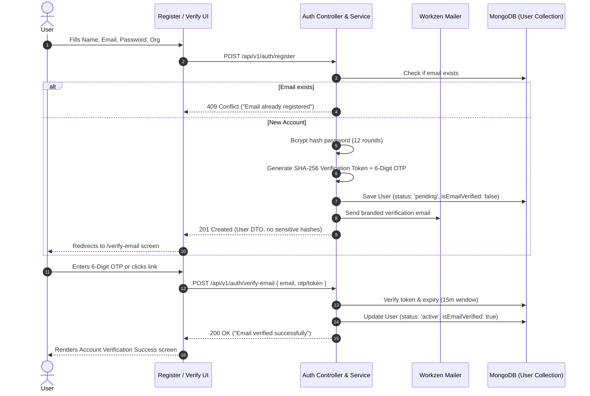
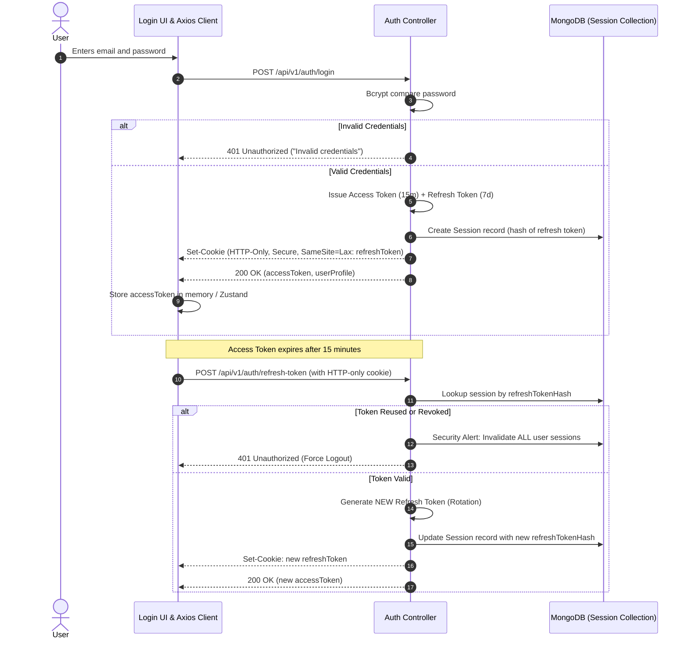
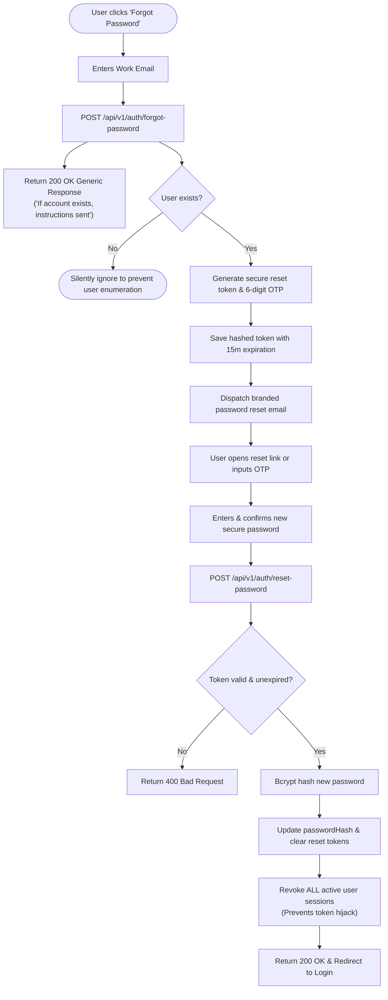
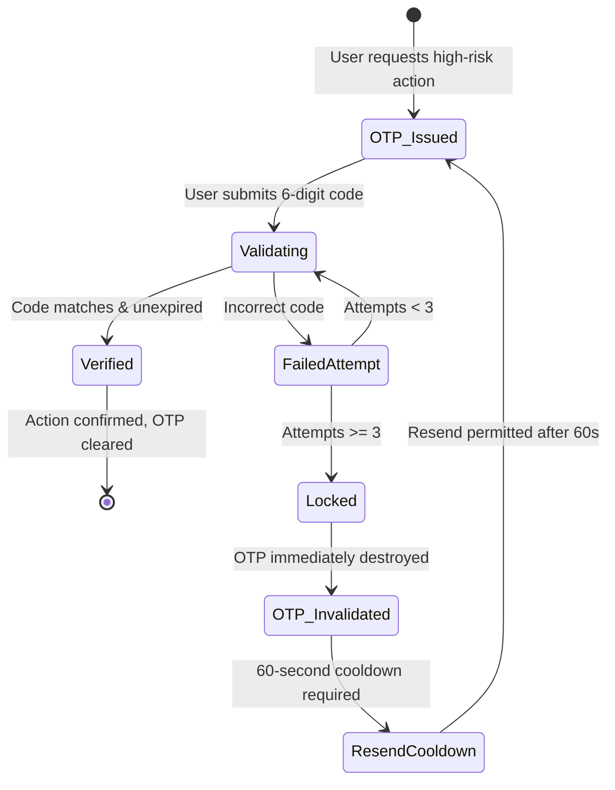
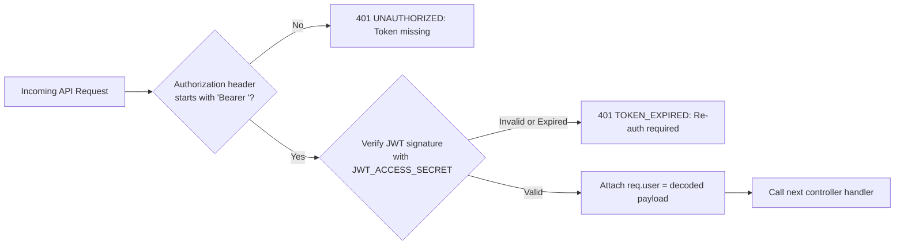
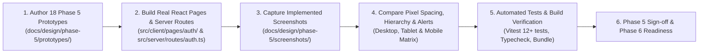

# WORKZEN — Phase 5 Authentication Architecture & Workflow Diagrams

This document contains the official architecture, sequence flows, token rotation models, and state machines for Phase 5 of **WORKZEN**.

---

## Diagram 1: Authentication System Architecture

---

## Diagram 2: User Registration & Email Verification Data Flow

---

## Diagram 3: Login & Rotating Refresh Token Session Lifecycle

---

## Diagram 4: Password Recovery & Session Revocation Workflow

---

## Diagram 5: OTP Verification & Anti-Brute-Force State Machine

---

## Diagram 6: Protected Route & Auth Middleware Pipeline

---

## Diagram 7: Prototype-to-Implementation Visual Comparison Pipeline

