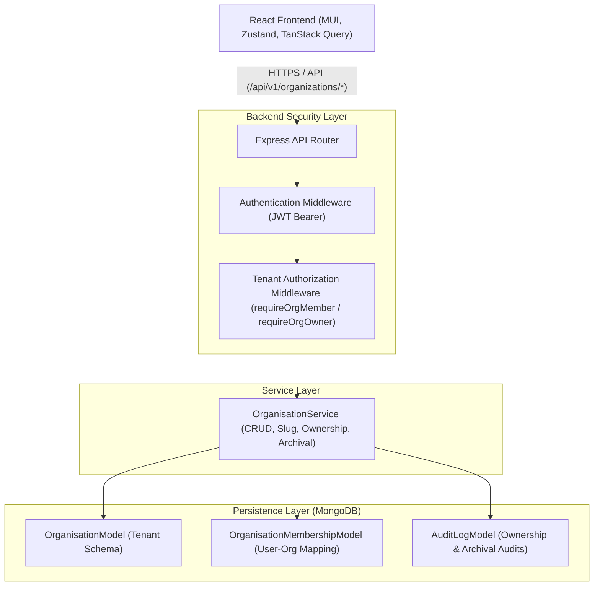
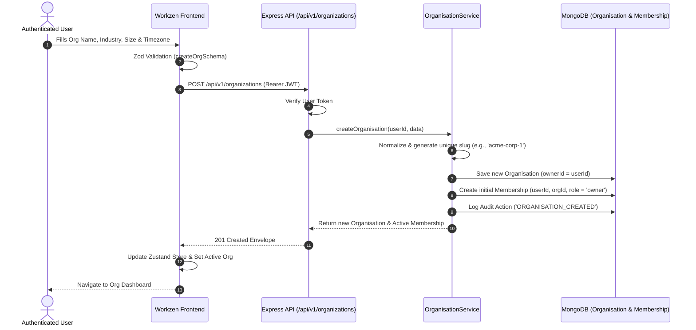
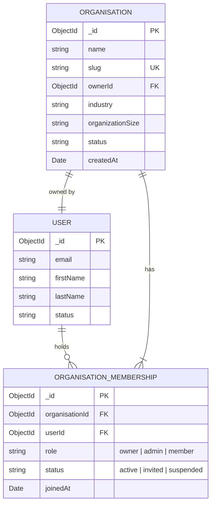
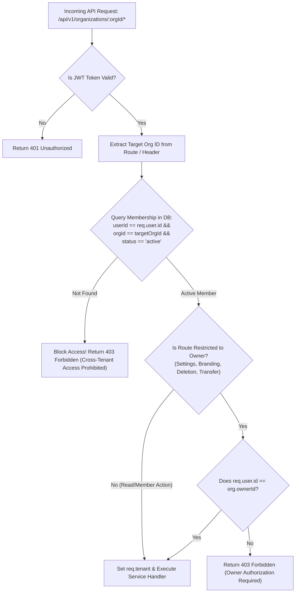
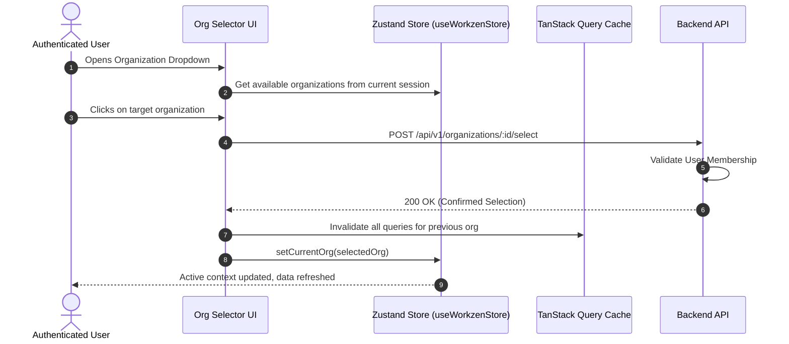
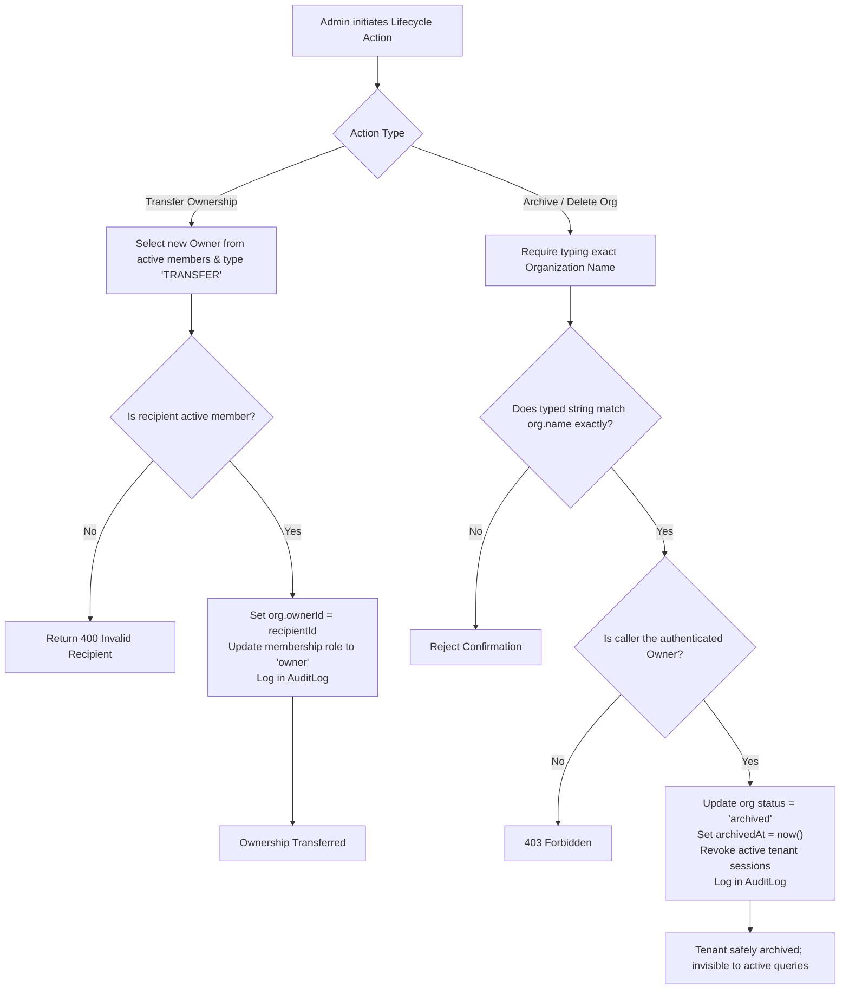
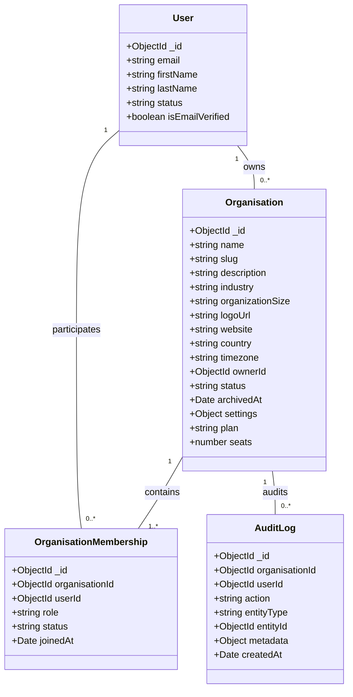

# WORKZEN — Phase 6 Architecture & Technical Diagrams
## Organization Management & Multi-Tenant Isolation

> **Product:** WORKZEN  
> **Tagline:** "Plan Smarter. Work Together. Achieve More."  
> **Phase:** 6 — Complete Organization Management System

---

## 1. Organization Management Architecture

---

## 2. Organization Creation Workflow

---

## 3. Organization Membership Relationship

---

## 4. Multi-Tenant Request Authorization Flow (IDOR Prevention)

---

## 5. Organization Selection Workflow

---

## 6. Organization Ownership Transfer & Deletion Workflow

---

## 7. Organization Database Relationship Diagram

