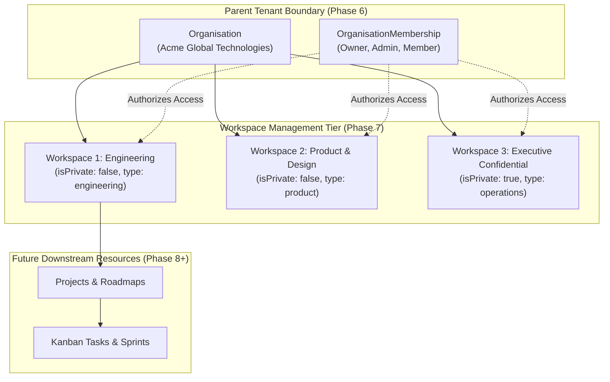

# WORKZEN — Phase 7: Workspace Management System Project Scan & Architecture Assessment

---

## 1. Executive Summary & Context

Phase 7 establishes the **Workspace Management System** for **WORKZEN** (*"Plan Smarter. Work Together. Achieve More."*). 

A Workspace in WORKZEN is the primary collaborative operational unit within an Organization. While the **Organization** represents the parent legal tenant, billing entity, and compliance boundary (Phase 6), the **Workspace** represents an agile team, department, or functional division (e.g. Engineering, Product & Design, Growth Marketing, Executive Ops). Workspaces group projects, task backlogs, sprint cycles, and members.

---

## 2. Mandatory Structural Hierarchy & Invariants



### Core Invariants:
1. **Strict Hierarchy:** Every workspace belongs to exactly one parent Organization (`organisationId: ObjectId`).
2. **Slug Isolation:** Slugs are uniquely scoped to the organization `{ organisationId: 1, slug: 1 }`, allowing different organizations to have a workspace named `/engineering` without collision.
3. **No Cross-Tenant Leaks (Anti-IDOR):** An authenticated user cannot access, select, list, or mutate a workspace unless they hold an active membership in the parent organization.
4. **Soft-Archival Lifecycle:** Deletion is safeguarded by soft-archival (`status: 'archived'`, `archivedAt: Date`). Archived workspaces are excluded from active selection menus and cannot receive new tasks or projects.
5. **Context Isolation:** When a user switches workspaces, the client updates the active workspace context and invalidates workspace-scoped queries without causing full-page reloads.

---

## 3. Database Schema Blueprint (`Workspace.ts`)

```typescript
export interface IWorkspaceDocument extends Document {
  organisationId: mongoose.Types.ObjectId; // Ref: Organisation
  name: string;                           // "Engineering Squad"
  slug: string;                           // "engineering"
  description?: string;
  type: 'engineering' | 'product' | 'marketing' | 'operations' | 'general';
  icon?: string;                          // Emoji or icon identifier
  logo?: string;                          // Cloudinary / uploaded URL
  themeColor?: string;                    // Hex brand accent (e.g. #6366F1)
  isPrivate: boolean;                     // Public to org or private
  status: 'active' | 'archived';
  archivedAt?: Date;
  archivedBy?: mongoose.Types.ObjectId;   // Ref: User
  createdBy: mongoose.Types.ObjectId;     // Ref: User
  settings?: {
    defaultTaskView?: 'kanban' | 'list' | 'calendar' | 'timeline';
    allowGuestAccess?: boolean;
    requireApprovalForProjects?: boolean;
  };
  createdAt: Date;
  updatedAt: Date;
}
```

---

## 4. RESTful API Blueprint

| Method | Endpoint | Access Rule | Description |
|---|---|---|---|
| `POST` | `/api/v1/organizations/:organizationId/workspaces` | Active Org Member | Create a new workspace within parent organization |
| `GET` | `/api/v1/organizations/:organizationId/workspaces` | Active Org Member | List all accessible workspaces in organization |
| `GET` | `/api/v1/workspaces/:workspaceId` | Workspace Member | Retrieve detailed workspace telemetry & metadata |
| `PATCH` | `/api/v1/workspaces/:workspaceId` | Workspace Creator / Org Admin | Update workspace profile (name, description, theme) |
| `GET` | `/api/v1/workspaces/:workspaceId/settings` | Workspace Member | Retrieve workspace operational settings |
| `PATCH` | `/api/v1/workspaces/:workspaceId/settings` | Workspace Creator / Org Admin | Update workspace operational settings |
| `POST` | `/api/v1/workspaces/:workspaceId/select` | Workspace Member | Validate and set active workspace session context |
| `PATCH` | `/api/v1/workspaces/:workspaceId/archive` | Workspace Creator / Org Admin | Soft-archive workspace with confirmation check |
| `PATCH` | `/api/v1/workspaces/:workspaceId/restore` | Workspace Creator / Org Admin | Reactivate an archived workspace |

---

## 5. Visual Prototype Strategy (Linear Dark + TaskFlow Light Benchmark)

All visual prototype screens for Phase 7 will be rendered at 1920×1080 (Desktop) and 800×1200 (Mobile) using the approved master design direction:
- Workspace creation & onboarding split layouts
- Modern popover workspace switchers with gradient highlight indicators
- Workspace overview with active projects, milestone trackers, and member rosters
- Detailed settings, appearance theming, and danger zone archival dialogs.

