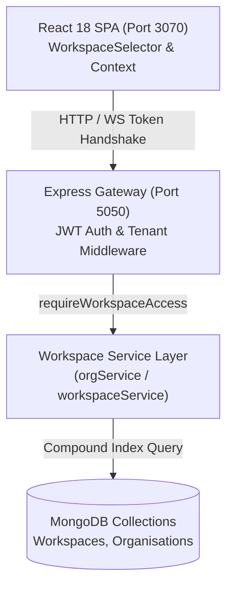
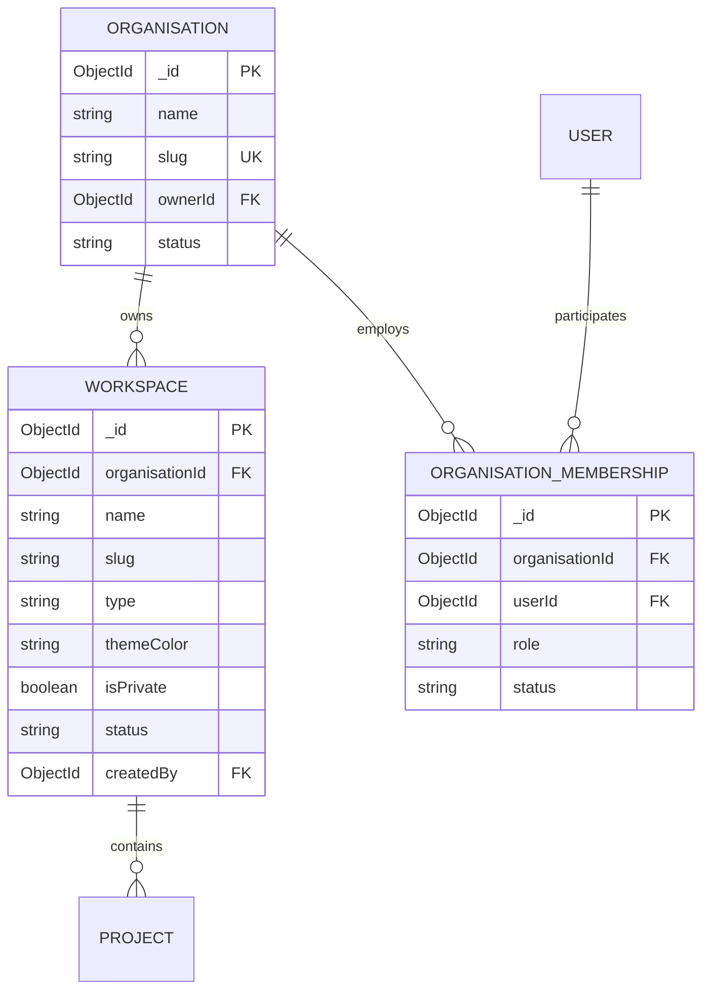
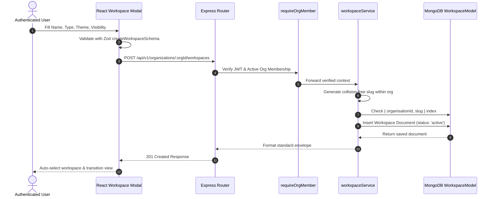
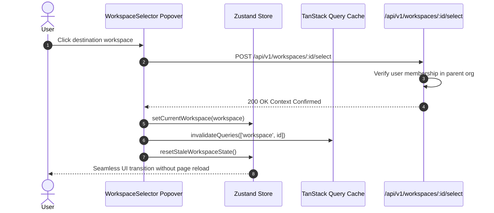
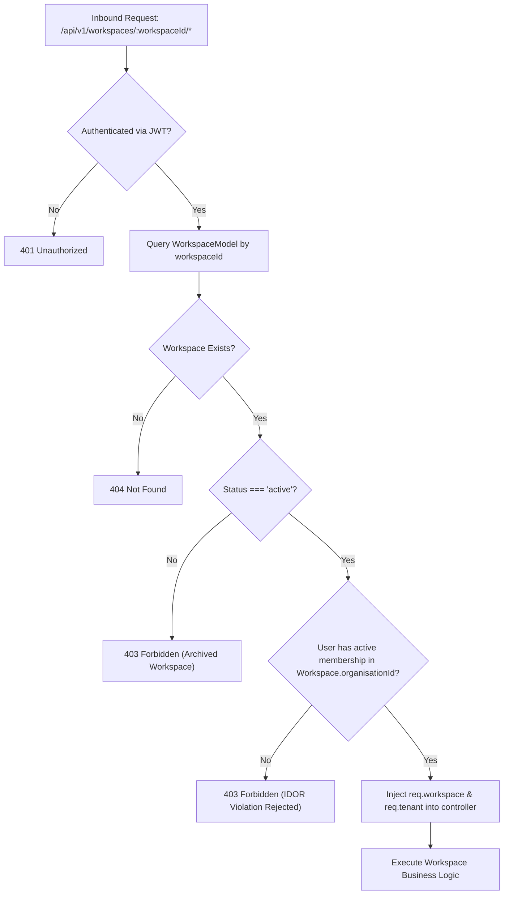

# WORKZEN — Phase 7: Workspace Management Architecture Diagrams

---

## 1. System Architecture Topology

---

## 2. Organization-to-Workspace Tenancy Boundary

---

## 3. Workspace Creation Flow

---

## 4. Workspace Selection & Context Switching

---

## 5. Multi-Tenant Authorization & Anti-IDOR Defense

