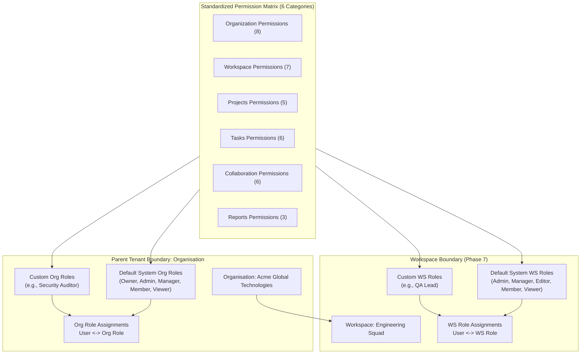

# WORKZEN — Phase 8: Enterprise Role-Based Access Control (RBAC) & Permissions Management
## Project Scan, Root-Cause Analysis & Architecture Assessment

---

## 1. Executive Summary & Context

Phase 8 introduces the comprehensive **Enterprise Role-Based Access Control (RBAC) and Permissions Management System** for **WORKZEN** (*"Plan Smarter. Work Together. Achieve More."*).

In Phases 5–7, WORKZEN established:
- **Phase 5:** Enterprise Authentication, Session Management, JWT Token Rotation, and Password Hashing.
- **Phase 6:** Multi-Tenant Organization Management, Tenant Boundaries, and Initial Ownership Rules.
- **Phase 7:** Workspace Management, Scoped Slugs, Privacy Levels, and Workspace Switching.

Prior to Phase 8, authorization was primarily determined by coarse role enums (`owner`, `admin`, `manager`, `member`, `guest`) hardcoded on `OrganisationMembership`. 

Phase 8 elevates WORKZEN to a true enterprise-grade SaaS security model by introducing:
1. **Granular Action & Resource Permissions:** Moving from hardcoded role string checks to fine-grained capabilities (`org:read`, `org:manage_roles`, `workspace:create`, `workspace:manage_access`, `project:read`, `task:create`, etc.).
2. **Dual-Scope Role Hierarchy:** Distinct organization-level roles (Organization Owner, Organization Admin, Manager, Member, Viewer) and workspace-level roles (Workspace Admin, Workspace Manager, Editor, Member, Viewer).
3. **Custom Role Engine:** Empowering enterprise admins to craft tailored roles (e.g., "Compliance Auditor", "Contract Developer", "Triage Lead") with customized capability matrices.
4. **Strict Permission Delegation Boundaries:** Preventing privilege escalation (an actor cannot grant permissions they do not possess or elevate themselves).
5. **Anti-IDOR & Multi-Tenant Isolation:** Roles and role assignments are strictly bound to their respective organization/workspace tenants.
6. **Immutable Audit Trail:** Comprehensive recording of role creation, modification, deletion, assignment, and revocation events.

---

## 2. Structural Hierarchy & Invariants



### Core Security Invariants:
1. **Scope Boundary Enforcement:** Organization-level roles govern tenant-wide actions; workspace-level roles govern operations confined to a specific workspace. An organization owner or admin can govern across workspaces, while a workspace admin can never elevate permissions in the parent organization.
2. **Protection of System Roles:** Built-in default roles (`isSystem: true`) are immutable in their core identity and cannot be deleted or renamed.
3. **Owner Protection Invariant:** The last remaining Organization Owner cannot be removed, suspended, or demoted without first transferring ownership to another active member.
4. **Privilege Escalation Prevention:** An actor attempting to create or edit a role cannot assign permissions that the actor themselves does not possess. Self-assignment to higher privilege is strictly rejected on the backend.
5. **Fail-Secure Architecture:** Authorization middleware defaults to denying access (`403 FORBIDDEN_PERMISSION_DENIED`) whenever a permission check cannot be verified with absolute certainty.
6. **Zero Stale State:** When role assignments change or roles are modified, client-side TanStack Query caches and permissions store are immediately updated and synchronized.

---

## 3. Database Schema Blueprint

### 3.1 Permission Model (`Permission.ts`)
```typescript
export interface IPermissionDocument extends Document {
  key: string;              // e.g., 'org:manage_roles', 'workspace:create'
  resource: 'org' | 'workspace' | 'project' | 'task' | 'collaboration' | 'report';
  action: string;           // e.g., 'read', 'update', 'delete', 'manage'
  name: string;             // Human-readable title: "Manage Organization Roles"
  description: string;      // Detailed description of the grant
  category: 'Organization' | 'Workspace' | 'Projects' | 'Tasks' | 'Collaboration' | 'Reports';
  scope: 'organization' | 'workspace';
  isSystem: boolean;
  createdAt: Date;
}
```

### 3.2 Role Model (`Role.ts`)
```typescript
export interface IRoleDocument extends Document {
  organisationId: mongoose.Types.ObjectId;  // Parent Tenant Ref
  workspaceId?: mongoose.Types.ObjectId;     // Present if scope === 'workspace'
  name: string;                             // "Security Auditor"
  slug: string;                             // "security-auditor"
  description: string;
  scope: 'organization' | 'workspace';
  isSystem: boolean;                        // true for default built-in roles
  isDefault: boolean;                       // default role for new members
  permissions: string[];                    // Array of permission keys
  createdBy?: mongoose.Types.ObjectId;      // Ref: User
  updatedBy?: mongoose.Types.ObjectId;      // Ref: User
  createdAt: Date;
  updatedAt: Date;
}
```

### 3.3 Role Assignment Model (`RoleAssignment.ts`)
```typescript
export interface IRoleAssignmentDocument extends Document {
  userId: mongoose.Types.ObjectId;          // Ref: User
  roleId: mongoose.Types.ObjectId;          // Ref: Role
  organisationId: mongoose.Types.ObjectId;  // Ref: Organisation
  workspaceId?: mongoose.Types.ObjectId;     // Ref: Workspace (if workspace role)
  scope: 'organization' | 'workspace';
  assignedBy: mongoose.Types.ObjectId;      // Ref: User
  assignedAt: Date;
}
```

---

## 4. RESTful API Endpoints Blueprint

| Method | Endpoint | Authorization Guard | Description |
|---|---|---|---|
| `GET` | `/api/v1/permissions` | Authenticated User | Retrieve full permission catalogue grouped by category |
| `GET` | `/api/v1/organizations/:organizationId/roles` | `org:read` | List all available organization and workspace roles |
| `POST` | `/api/v1/organizations/:organizationId/roles` | `org:manage_roles` | Create a new custom role with granular permissions |
| `GET` | `/api/v1/roles/:roleId` | Org Member | Retrieve single role details with associated permission definitions |
| `PATCH` | `/api/v1/roles/:roleId` | `org:manage_roles` | Update custom role details and permission grants |
| `DELETE` | `/api/v1/roles/:roleId` | `org:manage_roles` | Delete custom role (guarded against system roles and active users) |
| `GET` | `/api/v1/organizations/:organizationId/role-assignments` | `org:manage_roles` | List all member role assignments within the organization |
| `POST` | `/api/v1/organizations/:organizationId/members/:userId/roles` | `org:manage_roles` | Assign a role to an organization member |
| `DELETE` | `/api/v1/organizations/:organizationId/members/:userId/roles/:roleId` | `org:manage_roles` | Revoke a role from an organization member |
| `GET` | `/api/v1/workspaces/:workspaceId/role-assignments` | `workspace:manage_roles` | List all member role assignments within a workspace |
| `POST` | `/api/v1/workspaces/:workspaceId/members/:userId/roles` | `workspace:manage_roles` | Assign a workspace role to a member |
| `DELETE` | `/api/v1/workspaces/:workspaceId/members/:userId/roles/:roleId` | `workspace:manage_roles` | Revoke a workspace role from a member |
| `GET` | `/api/v1/organizations/:organizationId/roles/audit-logs` | `org:manage_roles` | Query immutable RBAC audit trail |

---

## 5. Visual Prototype & Redesign Strategy

In accordance with Phase 1–7 visual benchmarks (Linear Dark Mode, B2B Popover Switchers, Reem Hospital Dialogs, Zuper Modern Grids), Phase 8 will render 15 high-fidelity Desktop (1920x1080) and Mobile (800x1200) visual prototypes + 7 architecture diagrams before writing frontend code.

