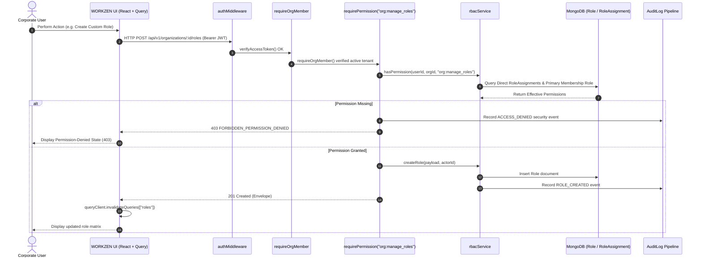

# WORKZEN — Phase 8: RBAC Architecture Diagrams & System Specifications

---

## 1. System Diagrams Overview

The following 7 architecture diagrams illustrate the complete authorization model and security guarantees of WORKZEN Phase 8:

| Diagram | Filename | Key Security / Architectural Guarantee |
|---|---|---|
| **1. Multi-Tenant Hierarchy** | `rbac-diag-01-tenant-hierarchy.png` | Strict separation of Organization-level and Workspace-level authority boundaries. |
| **2. Permission Domains** | `rbac-diag-02-permission-categories.png` | 35 granular action grants mapped across 6 operational domains. |
| **3. Delegation Boundary** | `rbac-diag-03-delegation-boundary.png` | Prevents privilege escalation; callers cannot grant permissions they do not possess. |
| **4. Role Assignment Flow** | `rbac-diag-04-role-assignment-flow.png` | Verifies tenant membership, actor authority, and safely mutates `RoleAssignment`. |
| **5. Middleware Decision Engine** | `rbac-diag-05-middleware-decision-flow.png` | Fail-secure `requirePermission()` evaluation flow on every protected API endpoint. |
| **6. Audit Trail Pipeline** | `rbac-diag-06-audit-trail-pipeline.png` | Tamper-proof recording of role lifecycle, assignments, and 403 authorization blocks. |
| **7. Cache Invalidation Flow** | `rbac-diag-07-cache-invalidation-flow.png` | Zero-stale client state synchronized via TanStack Query and Zustand. |

---

## 2. Mermaid Workflow Blueprint

